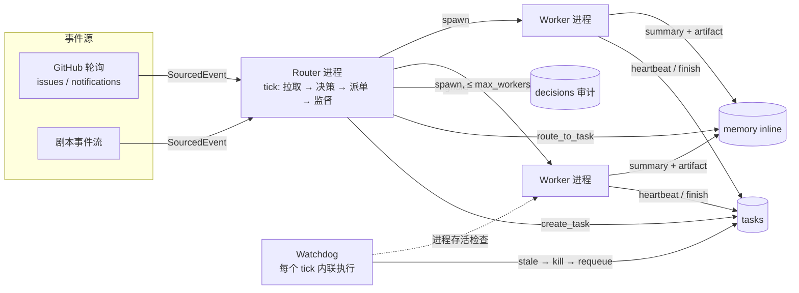
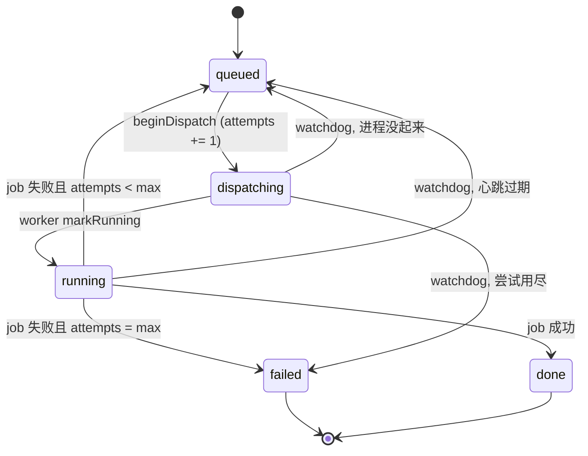

# 架构

SuperMeta 只有三类进程：**事件源**（被动）、**一个 Router**、**若干 Worker**。它们之间唯一的共享介质是 SQLite。

## 一次 tick 的顺序

`Router.tick()` 是同步可重入的，顺序固定，任何一步失败都不会让状态进入中间态：

1. **poll** — `source.poll()` 返回新事件；异常只记日志，不让 tick 崩掉。
2. **ingest** — `events.id` 唯一约束去重；重复事件直接丢弃。
3. **decide** — 每条新事件调用一次 `decide()`，写一条 `decisions` 记录（含 action 与 reason），然后：
   - `ignore` → 事件标记 ignored，结束；
   - `route_to_task` → 事件内容作为 inline memory 追加到已有任务，不产生新任务；
   - `create_task` → 建 `queued` 任务。
4. **dispatch** — `free = max_workers - countRunning()`，按 `priority desc, created_at asc` 取至多 `free` 个 `queued` 任务，先转 `dispatching`（`attempts += 1`），再 spawn 进程。spawn 失败立刻 `requeue`。
5. **supervise** — 跑一次 watchdog sweep，见下。

## 任务状态机

不变量：

- `attempts` **只在派发时** +1，不在完成时。这样「派出去了但进程没起来」也会被计入，不会无限重试。
- 任一时刻 `state in (dispatching, running)` 的任务数 ≤ `max_workers`。
- 一个 `thread` 同时最多一个活跃任务（`queued|dispatching|running|blocked`），这是线程订阅能成立的前提。
- 每条被摄取的事件恰好产生一条 decision，不存在「静默丢弃」。

## 心跳与看门狗

Worker 每 `stale_ms / 5` 毫秒写一次 `tasks.heartbeat_at` 和 `workers.heartbeat_at`。这个定时器**独立于 job 本身**，所以：

- job 只是慢 → 心跳还在 → 不动；
- job 把事件循环卡死 → 心跳停 → 判定停滞；
- 进程被杀 → 心跳停 → 判定停滞。

watchdog 每个 tick 扫一次 `dispatching|running` 的任务，用 `heartbeat_at`（没有则 `updated_at`）和当前时间比：

| 场景 | 动作 |
|---|---|
| 进程还活着 | `SIGKILL` |
| 有未关闭的 run | 写 `finished_at` + `note = "stale: ..."` |
| `attempts < max_attempts` | 回 `queued` |
| `attempts >= max_attempts` | `failed`，保留 `last_error` |

`--dry-run` 只报告不动手，方便在生产环境先观察。

## 上下文：inline / spill

长跑的核心问题是上下文会单调增长。SuperMeta 的做法是把「会被读的」和「会被存的」分开：

- **inline**：任务完成后的摘要，`clamp(summary, 400)` 字符，永久留在 `memory` 表里，每次组装上下文时取最近 8 条；
- **spill**：完整记录（摘要 + checklist + 生成的文档）写到 `~/.supermeta/artifacts/<thread>/<task_id>.md`，`memory` 表里只存路径和字符数；
- **recall**：worker 只拿到路径列表，需要时读文件；不需要时这些字符从未进入上下文。

`supermeta memory <thread>` 会直接打印这个比例，`runs.inline_chars / spill_chars` 则按次累计，便于统计。

## 失败模式

| 现象 | 检测方式 | 处理 |
|---|---|---|
| Worker 崩溃 | 心跳停止 | requeue，attempts 已预扣 |
| Worker 死循环 | 心跳停止（事件循环阻塞） | SIGKILL + requeue |
| 派发后进程没起来 | `dispatching` 超过 `grace_ms` | requeue |
| 一直失败 | `attempts == max_attempts` | `failed` + `last_error` |
| 事件重复投递 | `events.id` 唯一约束 | 丢弃 |
| Router 重启 | 状态在 SQLite | 继续，不需要恢复逻辑 |
| 同一线程事件洪峰 | `findActiveTaskByThread` | 全部并入一个任务 |

## 为什么不用管道

Router 和 Worker 之间不走 stdout、不走 socket，只走数据库。这样 Worker 的输出永远不会反压 Router，Worker 也可以在任何时候被替换；代价是协调延迟从微秒变成毫秒，对这个场景足够了。
